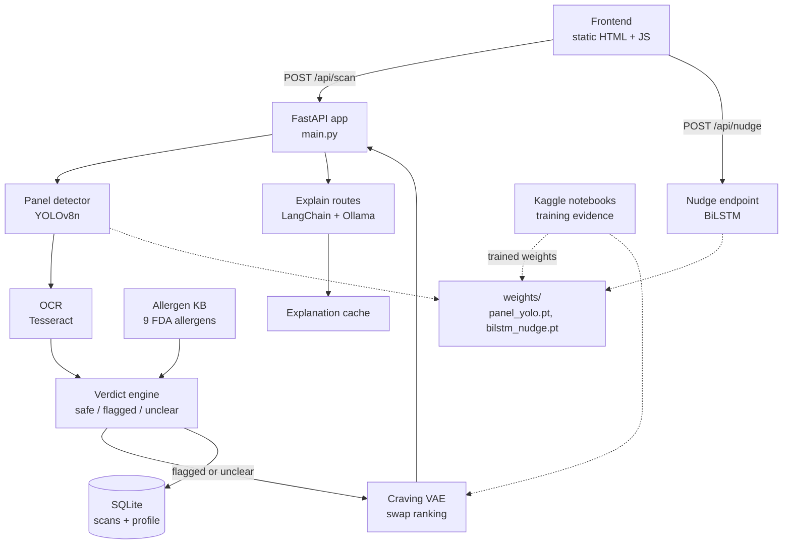

# 🥗 SafeBite-DL

**Scan the label. Get an honest verdict. Get a swap that actually matches your craving.**


SafeBite-DL is a food-label scanner for people with allergies. You photograph a label, and the app tells you whether the product is **safe**, **flagged** or **unclear** for your allergen profile. If it is off-limits, it suggests a swap ranked by taste and texture instead of a generic "healthier option".

> **Honest-results policy:** every model in this repo is reported with its real metric, and each one is marked as *integrated*, *proof of concept* or *report only*. Where a learned model did not beat its non-learned baseline, we say so.

## Table of contents

- [Why it is useful](#why-it-is-useful)
- [Architecture](#architecture)
- [Getting started](#getting-started)
- [Usage examples](#usage-examples)
- [Models and results](#models-and-results)
- [Training notebooks](#training-notebooks)
- [Project structure](#project-structure)
- [Getting help](#getting-help)
- [Maintainers and contributing](#maintainers-and-contributing)

## Why it is useful

| 🛡️ The safety problem | 🍟 The craving problem |
|---|---|
| Allergens hide behind scientific names, E-numbers and "natural flavouring". Most scanners answer with false confidence. | When a food is off-limits, the usual advice ignores *why* you wanted it: the crunch, the salt, the ritual. |
| SafeBite answers **safe / flagged / unclear** and defaults to *unclear* when it cannot read the label. | SafeBite ranks swaps on texture, flavour and mouth-feel, and never suggests an allergen you have. |

**Key features**

- **Deterministic three-state verdict** that is auditable line by line. A wrong "safe" is a health risk, so this decision is deliberately *not* learned.
- **9 FDA major allergens** with alias matching (casein, whey, ghee → milk) and word-boundary regex (so "oat" does not match "coat").
- **Fail-safe OCR gate:** unreadable labels return `unclear`, never `safe`.
- **Craving-matched swaps** from a VAE trained on 20,000 Open Food Facts products, with allergen exclusion.
- **YOLOv8 product detector** that crops the product before OCR.
- **Proactive nudge endpoint** (BiLSTM) that flags drift toward risky foods, trained on *simulated* scan history.
- **LLM explanations** (Ollama, optional) with a persistent cache.
- **Graceful fallbacks:** if model weights are missing, the pipeline still works.

## Architecture



> GitHub renders Mermaid diagrams but, as far as we know, ignores the `click` links above. They work in the [Mermaid Live Editor](https://mermaid.live), VS Code's Mermaid preview and GitLab. The table below gives the same links in a form GitHub always supports.

### Component map

| Component | What it does | Source |
|---|---|---|
| Frontend | Static pages: scan, verdict, swaps, history, settings | [`frontend/`](frontend/) |
| API and verdict engine | Routes, OCR call, three-state verdict | [`backend/app/main.py`](backend/app/main.py) |
| Panel detector | YOLOv8 crop with whole-image fallback | [`backend/app/ai/detector.py`](backend/app/ai/detector.py) |
| Allergen knowledge base | 9 allergens with aliases | [`backend/app/data/allergen_kb.py`](backend/app/data/allergen_kb.py) |
| Craving VAE | Swap catalog and ranking | [`backend/app/ai/craving_vae.py`](backend/app/ai/craving_vae.py) |
| Explanations | LangChain chains, prompts, Ollama client | [`backend/app/api/explain_routes.py`](backend/app/api/explain_routes.py), [`backend/app/ai/`](backend/app/ai/) |
| Explanation cache | Persistent cache for LLM output | [`backend/app/cache/explanation_cache.py`](backend/app/cache/explanation_cache.py) |
| Nudge model | BiLSTM risk score from scan history | [`backend/app/ai/nudge.py`](backend/app/ai/nudge.py), [`backend/app/api/nudge_routes.py`](backend/app/api/nudge_routes.py) |
| Persistence | SQLite for scans and profile | [`backend/app/core/database.py`](backend/app/core/database.py) |
| Model weights | `panel_yolo.pt`, `bilstm_nudge.pt` | [`backend/app/ai/weights/`](backend/app/ai/weights/) |
| Training evidence | Kaggle notebooks and plots | [`notebooks/`](notebooks/), [`docs/results/`](docs/results/) |

## Getting started

### Prerequisites

- Python 3.10 or newer
- [Tesseract OCR](https://github.com/tesseract-ocr/tesseract) installed on your system (`sudo apt install tesseract-ocr` on Ubuntu, `brew install tesseract` on macOS, or the Windows installer with `TESSERACT_CMD` set)
- *(Optional)* [Ollama](https://ollama.com) with `llama3.2` for LLM explanations

### Run the backend

```bash
cd backend
python -m venv venv
source venv/bin/activate            # Windows: venv\Scripts\activate

# CPU-only PyTorch keeps the install small
pip install torch --index-url https://download.pytorch.org/whl/cpu
pip install -r requirements.txt

uvicorn app.main:app --reload --host 0.0.0.0 --port 8000
```

Open <http://localhost:8000/docs> for the interactive API docs.

### Add the model weights

Place the trained weights in `backend/app/ai/weights/`:

```
backend/app/ai/weights/panel_yolo.pt
backend/app/ai/weights/bilstm_nudge.pt
```

Both are small (about 6 MB and 15 KB). If a file is missing, the detector returns the whole image and the nudge endpoint returns `risk: null`, so the rest of the app keeps working. See [`notebooks/`](notebooks/) for how the weights were trained.

### Run the frontend

The frontend is static, with no build step:

```bash
cd frontend
python -m http.server 5500
```

Open <http://localhost:5500>. If your backend is not on `localhost:8000`, set `API_BASE` in the frontend's `app.js`.

### Run the tests

```bash
cd backend
pytest
```

## Usage examples

**Scan a label** (check [`/docs`](http://localhost:8000/docs) for the exact upload field name):

```bash
curl -X POST http://localhost:8000/api/scan -F "file=@label.jpg"
```

**Ask the nudge model about recent scans.** Each scan is `[verdict_code, hour/24, days_since_last/30]`, where verdict code is `0` safe, `0.5` unclear, `1` flagged:

```bash
curl -X POST http://localhost:8000/api/nudge \
  -H "Content-Type: application/json" \
  -d '{"scans": [[0,0.5,0.1],[0.5,0.6,0.2],[1,0.7,0.1],[1,0.8,0.1],[1,0.9,0.1]]}'
```

```json
{ "risk": 0.99, "nudge": true, "simulated": true }
```

The `simulated` flag is intentional: the model was trained on synthetic scan sequences.

**Main endpoints** (full reference at `/docs`):

| Method | Endpoint | Purpose |
|---|---|---|
| POST | `/api/scan` | Label photo → verdict |
| GET | `/api/swaps/{scan_id}` | Swaps for a flagged or unclear scan |
| GET | `/api/swaps?q=` | Swaps for a typed craving |
| POST | `/api/nudge` | Risk score from recent scan history |
| POST | `/explain-swap` | Why a swap fits (needs Ollama) |

## Models and results

Each model is benchmarked against the non-learned thing it replaces, with its real numbers.

| Model | Result | Status |
|---|---|---|
| **Craving VAE** (numpy) | Recon loss 2.62, KL 0.70 on 20,000 Open Food Facts products; clean sweetness gradient in latent space | ✅ Integrated |
| **YOLOv8n panel detector** | mAP50 0.922, mAP50-95 0.640, about 3 ms/image on a T4 | ✅ Integrated (detects a generic *Product* class, not nutrition panels) |
| **Scan-history BiLSTM** | About 98% validation accuracy on **simulated** sequences | 🧪 Integrated as `/api/nudge`, labelled simulated |
| **CRNN + CTC OCR** | CER 0.0008 on **synthetic** rendered text | 🧪 Proof of concept; Tesseract stays the default |
| **MLP optimizer comparison** | Fashion-MNIST: Adam 88.5%, RMSProp 87.1%, SGD 86.9%. On allergen data all three collapsed to the majority class | 📄 Report only; justifies the rule-based verdict |
| **Conditional GAN** | Discriminator loss stayed near chance (about 1.38) | 📄 Report only |
| **Attention captioner** | BLEU 0.11 on Flickr8k | 📄 Report only |
| **Verdict engine** | Deterministic rules, alias-aware, fail-safe to *unclear* | ✅ Working |

### 🔒 The one thing we deliberately did not learn

The safety verdict is rule-based. A wrong "safe" costs someone's health, so the highest-stakes decision stays the simplest and most inspectable. Our own MLP experiment backs this up: with nutrient features alone, learned classifiers predicted the majority class and missed most allergen cases.

Plots and metrics are collected in [`docs/results/`](docs/results/).

## Training notebooks

All models were trained and evaluated on Kaggle. The notebooks are in [`notebooks/`](notebooks/).

| Notebook | What it does |
|---|---|
| `00_mlp_fashion_mnist` | Compares SGD, Adam and RMSProp on Fashion-MNIST |
| `01_mlp_vae_bilstm` | MLP allergen baseline, Craving VAE on 20k products, BiLSTM nudge on simulated data |
| `02_ocr_crnn` | CNN + BiLSTM + CTC text recogniser on synthetic label images |
| `03_yolo_panel_detector` | YOLOv8n trained on a Roboflow product-detection dataset |
| `04_cgan` | Conditional GAN for label-image augmentation |
| `05_captioner` | ResNet features + attention LSTM captioner on Flickr8k |
| `06_integration_demo` | End-to-end trace: OCR text → verdict → VAE swap |

Data sources: [Open Food Facts](https://world.openfoodfacts.org), [Flickr8k](https://www.kaggle.com/datasets/shadabhussain/flickr8k), and a Roboflow Universe product-detection dataset.

## Project structure

```
.
├── backend/
│   ├── app/
│   │   ├── main.py              # routes, OCR, verdict engine
│   │   ├── api/                 # explain_routes.py, nudge_routes.py
│   │   ├── ai/
│   │   │   ├── craving_vae.py   # VAE + swap catalog
│   │   │   ├── detector.py      # YOLOv8 panel detector
│   │   │   ├── nudge.py         # BiLSTM nudge model
│   │   │   ├── chains.py · prompts.py · llm.py · output_parser.py
│   │   │   └── weights/         # panel_yolo.pt, bilstm_nudge.pt
│   │   ├── data/allergen_kb.py  # 9-allergen knowledge base
│   │   ├── cache/               # explanation cache
│   │   ├── schemas/ · core/     # models, config, database, logging
│   ├── tests/
│   └── requirements.txt
├── frontend/                    # static pages + app.js
├── notebooks/                   # Kaggle training notebooks
├── docs/results/                # plots and metrics
└── illustrations/
```

## Getting help

- **API questions:** run the backend and open `/docs` for the interactive reference.
- **Bugs or questions:** open an [issue](../../issues) in this repository.
- **Model details and numbers:** see [`docs/results/`](docs/results/) and the [training notebooks](#training-notebooks).

## Maintainers and contributing

Built by **Dharmi**, **Jasmine** and **Rajasree** for *CSE4006 Deep Learning* at VIT-AP University.

Contributions are welcome:

1. Fork the repo and create a branch (`git checkout -b feature/my-change`).
2. Make your change and run `pytest` in `backend/`.
3. Open a Pull Request describing what changed and why.

Please keep the safety verdict deterministic. Changes that make it learned need strong evidence that they are never less safe than the rules.

## References

Open Food Facts · USDA FoodData Central · FDA FALCPA · FARE · YOLOv8 (Ultralytics) · CS Girlies Annual Hackathon (original SafeBite spec)